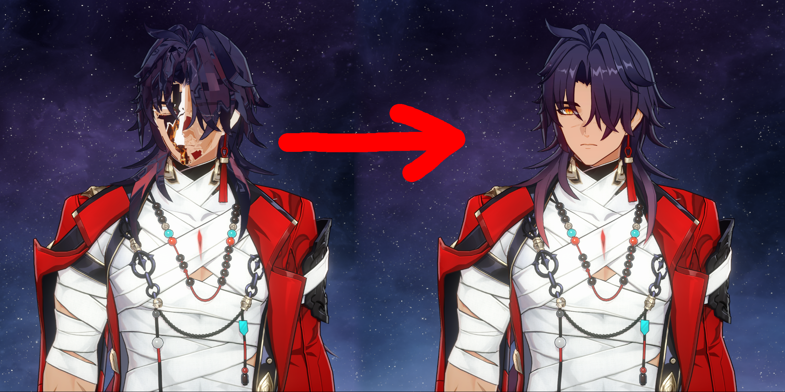

# Mortenax Texcoord Updater

Mortenax Blade's hair and face texcoords were changed in such a way that mods require more than just a hash change to fix. This script updates the ini with new hashes and strides and converts the texcoord buffers to the new format.

Run it with no arguments (`python MortenaxTexcoordUpdater.py` or double click the script) to recursively search all inis in the same directory as the script.
Run it with a directory as an argument (`python MortenaxTexcoordUpdater.py <path to directory>`) to recursively search all inis in that directory.
Run it with an ini file as an argument (`python MortenaxTexcoordUpdater.py <path to ini>`) to only act on that one ini.

