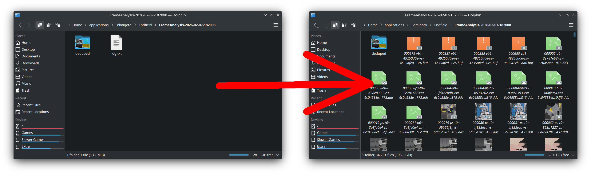

# Symlink Framedumps
Simple script for linux users to read log.txt in framedump folders and create the symlinks EFMI tools expects since 3dmigoto fails to create symlinks under wine/proton.

THIS IS NOT NEEDED ON WINDOWS

To use, drop the script in your EFMI folder and run it.

