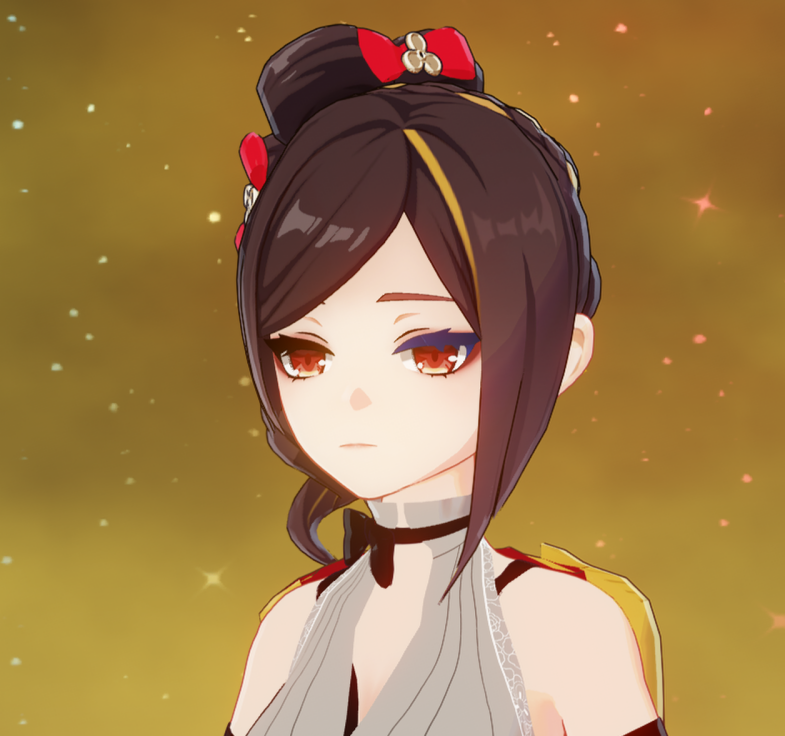

# XXMI Buffer Export

This is a blender plugin to export individual buffers that are compatible with the originally imported model. Useful for situations where you want to make a change to one buffer without without editing the rest, such as changing the UV map without changing the rest of the model. Useful for things like proportion edits, fixing weights (\**cough*\*nihiluxwrist*\*cough*\*), or editing the UV to allow for asymmetry. IB export is only really useful if you did something to mess with vertex order in which case you could just do a normal export, but it's there for completeness.

Note: If there are any vertices shared between different parts of the same mesh (such as BodyA and BodyB), this tool will fail to export a compatible buffer unless you modify the dump before importing so it gets imported as a single part.

How to use:
1. Import a model
2. Make your edits (If you do anything that changes the vertex count or order, you'll have to export all 4 buffers)
3. Make sure the dump folder, output folder, and game are set correctly in the XXMI panel
4. At the bottom of the main XXMI panel, click the button for the buffer you want to export
5. Create an ini file to replace whichever buffer(s) you exported and any textures you want to use

